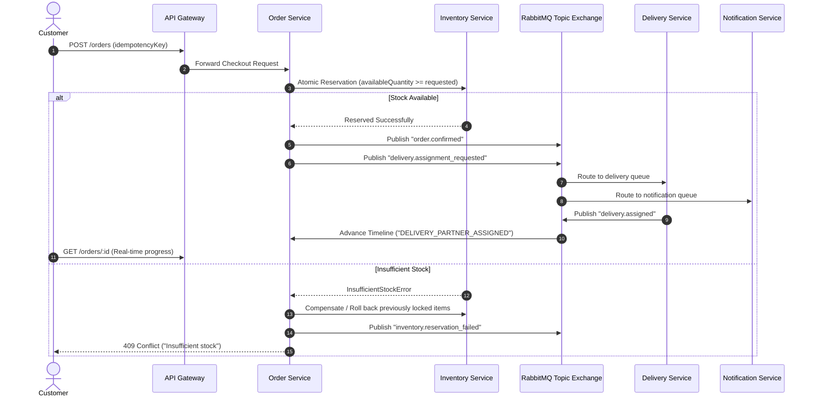

# RabbitMQ Event-Driven Messaging & Saga Flow

Exchange: `quickcommerce.events` (Topic Exchange)

## 1. Domain Event Topics

- `order.created`: Emitted when an order request passes initial validation.
- `inventory.reserved`: Emitted when atomic stock reservation succeeds.
- `inventory.reservation_failed`: Emitted when available stock is insufficient.
- `inventory.updated`: Emitted on stock updates to evict stale cache entries.
- `order.confirmed`: Emitted when reservation succeeds, triggering dispatch.
- `order.cancelled`: Emitted on user or timeout cancellation, triggering compensation.
- `delivery.assignment_requested`: Emitted to prompt rider fleet assignment.
- `delivery.assigned`: Emitted when a rider accepts an order.
- `delivery.status_updated`: Emitted when delivery reaches `PICKED_UP`, `OUT_FOR_DELIVERY`, or `DELIVERED`.
- `notification.requested`: Emitted to trigger customer in-app alerts.

---

## 2. Event Workflow Progression

---

## 3. Reliability & Dead-Letter Queue (DLQ)
- **Exchange**: `quickcommerce.events` with DLX `quickcommerce.dlx`.
- **Dead-Letter Queue**: Repeatedly failing consumer messages (after 3 bounded retries) are rejected and routed to `quickcommerce.dlq`.
- **Deduplication**: Consumers maintain an in-memory or persisted `processedEventIds` set to enforce idempotent consumption.
